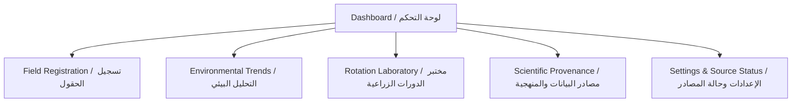

# AgroShift — Product Requirements Document (PRD)

**Document Version:** 1.0.0-PROVISIONAL  
**Status:** Approved for Implementation Phase 1  
**Target Event:** NASA Space Apps Challenge 2026  
**Geographic Focus:** Arab Republic of Egypt (Nile Delta and Nile Valley)

---

## 1. Problem Statement

Farmers, agricultural engineers, and extension specialists in the Nile Delta and Valley face escalating agronomic pressures:
- **Increasing heat stress and seasonal climate variability** altering historical sowing windows and vegetative cycles.
- **Water scarcity and irrigation constraints** requiring precision monitoring of reference evapotranspiration ($ET_0$) and crop water consumption ($ET_c$).
- **Soil salinity and degradation** resulting from intensive mono-cropping or ill-suited rotation sequences.
- **Opaque decision-making tools**: Many digital tools offer black-box "AI recommendations" that lack scientific provenance, fail to cite reference equations, or make unwarranted promises regarding yield and profit.

**AgroShift** provides an evidence-based, transparent, Arabic-first mobile application that processes verified agro-meteorological observations, evaluates physiological suitability and water balance, and allows users to compare rotation plans without black-box yield claims.

---

## 2. Target Users and Persona Needs

| Persona | Role | Primary Need | Application Value |
|---|---|---|---|
| **Hajj Ahmed (Farmer)** | Smallholder / medium farm manager in Kafr El-Sheikh (Delta) | Simple, Arabic-first view of current heat stress, weekly $ET_0$, and whether clover followed by maize or wheat is biologically safer. | Direct Arabic indicators, clear risk levels, offline-first access to last cached metrics. |
| **Eng. Mariam (Agronomist / Extensionist)** | Field agricultural engineer in Beheira / Minya | Transparent calculations of Degree Days (GDD), historical heat extremes, and multi-year rotation water balance. | Exportable data provenance, explicit FAO-56 formulas, sensor/model origin display. |
| **NASA Space Apps Judges / Scientific Reviewers** | Scientific panel | Verification that gridded datasets are not confused with point truth, and that recommendations degrade gracefully under uncertainty. | Full data provenance panel, uncertainty warnings, refusal to recommend under missing inputs. |

---

## 3. Confirmed vs. Proposed Requirements

### 3.1 Confirmed Requirements (Core Baseline)
1. **Egyptian Geography Specialization:** Hardcoded geographical boundaries and validation for Egypt (latitudes 22.0°N to 31.8°N, longitudes 25.0°E to 37.0°E), with focused presets for Nile Delta & Valley governorates.
2. **Arabic-First Interface & RTL Awareness:** Native RTL layout with appropriate Arabic typography, verified truncation limits, and bilingual terminology where scientific terms are standardized.
3. **Transparent Scientific Methodology:** Implementation of standard agronomic formulas (FAO-56 Penman-Monteith $ET_0$, Crop Water Needs $ET_c = K_c \times ET_0$, Growing Degree Days $\text{GDD}$).
4. **Data Integrity & Non-Fabrication:** Strict refusal to fabricate observations; explicit missing-data handling; rejection of out-of-range physical values.
5. **Conservative Decision Support:** Clear non-guarantee disclaimer: **The application does not guarantee crop yields or profits.** When input data is incomplete or outside scientific validity ranges, the system transitions to an `InsufficientEvidence` state rather than producing a speculative recommendation.
6. **Provider-Agnostic Core:** Decoupled domain repository contracts isolating current external providers (Open-Meteo, NASA POWER) from upcoming competition APIs.

### 3.2 Proposed Requirements (Evaluated for Release 1.0 vs Deferred)
- *Proposed & Included (v1.0):* Offline local caching of environmental queries using local database/store for resilient field use.
- *Proposed & Included (v1.0):* Offline multi-season crop-rotation scenario builder (Summer/Nile/Winter cycles).
- *Proposed & Deferred (Post v1.0):* Exporting PDF scientific dossier (deferred until core calculation and provenance screens pass verification).
- *Proposed & Excluded (Strict Scope Exclusion):* User account creation, cloud-sync backend, payment systems, black-box machine learning yield predictions.

---

## 4. Screen Inventory and User Journeys

### Screen 1: Dashboard (`/dashboard` - لوحة التحكم الميدانية)
- **Purpose:** Quick glance at active field status, current 7-day cumulative $ET_0$, heat-stress alerts, and active crop stage.
- **States:** Empty (no field registered), Loading, Loaded, Error/Stale Data warning.
- **Inputs:** Select active field selector.
- **Outputs:** Current agro-climatic summary card, heat stress level, active crop water demand badge.

### Screen 2: Field Registration & Coordinates (`/fields` - إدارة الحقول الزراعية)
- **Purpose:** Register and edit field locations within Egypt.
- **Inputs:** Field name, Governorate selection (e.g., Kafr El-Sheikh, Gharbia, Minya, Fayoum), Latitude/Longitude coordinates (with validation), Soil type class (Clay, Clay Loam, Sandy Loam, Sandy).
- **Validation:** Coordinates strictly constrained to Egypt bounding box (Lat: [22.0, 31.8], Lon: [25.0, 37.0]).
- **Outputs:** Stored field entity.

### Screen 3: Field Map / Coordinate Inspector (`/map` - فاحص الموقع الجغرافي)
- **Purpose:** Visual confirmation of field coordinates over Nile Basin topography with offline boundary guidance.

### Screen 4: Environmental Analysis & Trends (`/environmental-analysis` - التحليل البيئي والمناخي)
- **Purpose:** Multi-variable historical and forecast time series inspection: $T_{max}$, $T_{min}$, Precipitation, FAO-56 $ET_0$, Heat index.
- **States:** Date range selector (7 days, 30 days, 1 season), Aggregation summaries, Missing-data indicators.
- **Integrity Rule:** Gridded model provenance banner showing grid coordinates, elevation offset, and generation timestamp.

### Screen 5: Crop-Rotation Comparison Laboratory (`/rotation-lab` - مختبر الدورات الزراعية)
- **Purpose:** Compare multi-season crop sequences (e.g., "Wheat -> Maize" vs. "Clover -> Maize" vs. "Wheat -> Rice") against water requirement, soil nitrogen balance impact, and temperature fit.
- **Integrity Rule:** Output displays comparative risk indices and water balance in $m^3/feddan$, not currency or yield promises. Displays "غير كافٍ للأدلة" (Insufficient Evidence) if temperature/climate range has high missingness.

### Screen 6: Scientific Report & Provenance (`/provenance` - المنهجية والمصادر العلمية)
- **Purpose:** Full transparency into equations, data sources, citations (FAO Irrigation Paper No. 56, Egyptian Ministry of Agriculture bulletins), provider metadata, and uncertainty documentation.

### Screen 7: Settings & Data Sources (`/settings` - الإعدادات وحالة الاتصال)
- **Purpose:** Toggle temperature units (°C vs K), water volume units ($mm$ vs $m^3/\text{feddan}$), check API connection latency, and clear local cache.

---

## 5. Acceptance Criteria

1. **AC-1 (Geographic Validation):** Reject any coordinate outside Egypt's borders with an informative Arabic error explaining acceptable ranges.
2. **AC-2 (Zero vs Missing):** Precipitation of 0.0 mm must be recorded as 0.0 mm, whereas unreturned days must be represented as `null`/`MissingData`, never 0.0.
3. **AC-3 (Scientific Unit Sanity):** All temperature data stored internally as Celsius with strict physical checks ($-10^\circ C \le T \le 60^\circ C$). All $ET_0$ values must satisfy $0 \le ET_0 \le 25\text{ mm/day}$.
4. **AC-4 (No Black-Box Yields):** Rotation laboratory must output water volume requirements ($m^3/\text{feddan}$), soil nutrient dynamics (nitrogen fixation vs exhaustion), and heat-stress risk scores. No dollar or ton-per-feddan guarantees.
5. **AC-5 (Graceful Degradation):** In offline mode, display cached data with a visible "بيانات مخزنة مؤقتاً" (Cached / Stale) badge and timestamp. If no cache exists, display an empty state with a retry option.
